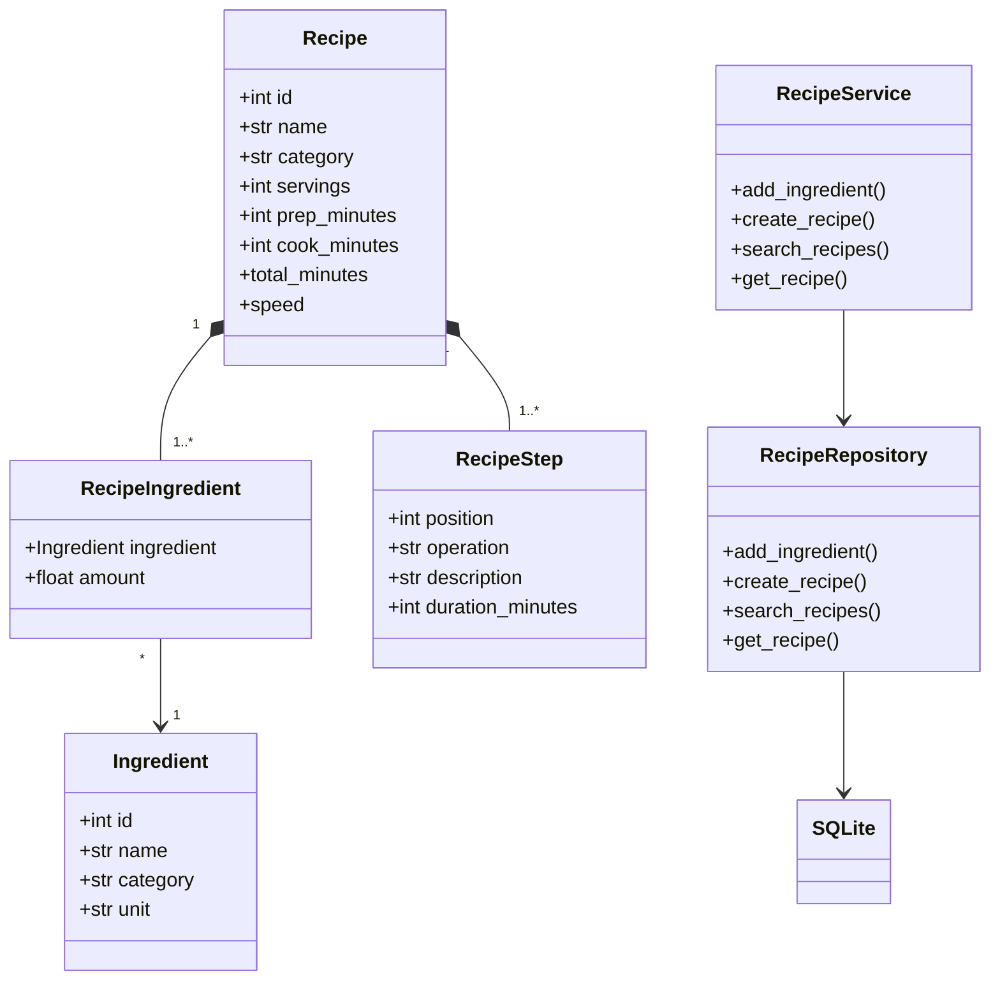

# Книга рецептов

Учебное консольное приложение на Python для составления рецептов, учёта ингредиентов и поиска блюд. Данные сохраняются в SQLite. Интерфейс и дополнительные библиотеки не требуются.

## Запуск

Из корневой папки проекта:

```powershell
python -m recipe_book
```

При первом запуске приложение создаёт базу `~/.recipe_book.sqlite3` и добавляет несколько примеров. Для выхода выберите `0`.

## Возможности

- ингредиенты с категориями и единицами измерения;
- рецепты с количеством порций, временем подготовки и готовки;
- последовательность шагов: жарка, варка, смешивание и другие операции;
- поиск по названию блюда, ингредиенту, категории, способу готовки, скорости и максимальному времени;
- просмотр полного рецепта и добавление собственных ингредиентов и блюд;
- фильтрация также по категории ингредиентов (например, «овощи» или «специи»).

Требуется Python 3.10 или новее.

Скорость определяется по общему времени: быстро — до 20 минут, средне — от 21 до 60 минут, долго — больше 60 минут. Несколько фильтров поиска применяются одновременно.

## Структура классов



## Проверка

```powershell
python -m unittest discover -s tests -v
```
